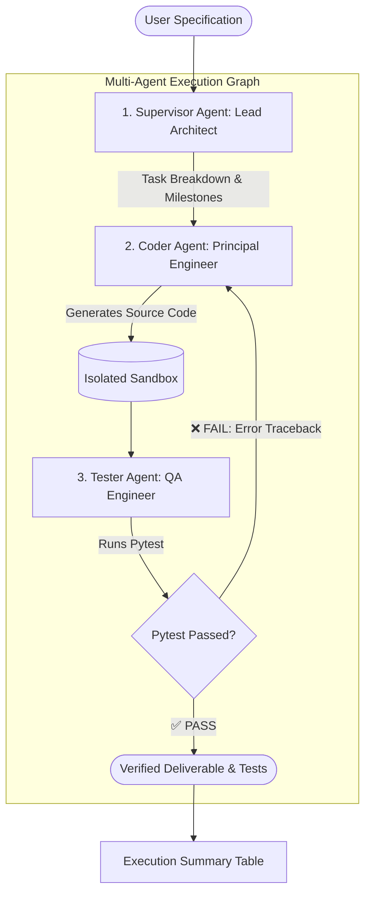

<div align="center">

# 🤖 Autonomous Multi-Agent Researcher & Coder

**A production-grade, test-driven multi-agent software development system with self-healing feedback loops.**

[](https://www.python.org/downloads/)
[]()
[](https://opensource.org/licenses/MIT)
[](https://github.com/astral-sh/ruff)
[]()

</div>

---

## 🌟 Overview

The **Autonomous Multi-Agent Researcher & Coder** is an autonomous engineering system capable of taking high-level user specifications and turning them into clean, tested, and verified Python code.

Unlike single-prompt generation tools that hallucinate and leave syntax errors unchecked, this system operates as a **coordinated team of specialized agents** governed by a state machine graph and an automated **test-driven self-healing loop**.

---

## 🏗️ System Architecture



### Specialized Micro-Agents:

1. **Supervisor Agent (Lead Architect):** Decomposes complex feature requests into discrete milestones, file targets, and architectural requirements.
2. **Coder Agent (Principal Engineer):** Equipped with sandboxed file tools (`read_file`, `write_file`, `list_directory`). Generates clean, idiomatic, fully-typed Python code.
3. **Tester Agent (QA & Verification):** Reads the implementation, writes exhaustive `pytest` test suites covering edge cases, executes them in the sandbox, and parses outcomes.
4. **Self-Healing Loop:** When unit tests fail, the tester sends the raw traceback back to the Coder. The Coder diagnoses the error, patches the implementation, and re-triggers testing until 100% of tests pass.

---

## ⚡ Key Engineering Features

- **Framework-Agnostic & Lightweight:** Built cleanly on Pydantic v2 and the OpenAI-compatible standard. No bloated or brittle dependencies.
- **Provider Flexibility:** Works out-of-the-box with **OpenAI** (`gpt-4o`, `gpt-4o-mini`), **Anthropic**, or **100% local, free, offline models** via **Ollama** (`llama3`, `qwen2.5-coder`).
- **Sandboxed File Operations:** Prevents path traversal vulnerabilities and confines agent writes strictly to the designated workspace.
- **Automated Self-Correction:** Eliminates manual debugging for syntax errors, missing imports, and logic bugs.

---

## 🚀 Getting Started

### 1. Clone the Repository
```bash
git clone https://github.com/tahadeab-ai/Multi-Agent-Researcher-and-Coder.git
cd Multi-Agent-Researcher-and-Coder
```

### 2. Setup Environment (Fast with `uv`)
```bash
# Using uv (recommended):
uv venv
# On Windows:
.venv\Scripts\activate
# On Linux/macOS:
source .venv/bin/activate

uv pip install -e ".[dev]"
```

Or using standard `pip`:
```bash
python -m venv .venv
# Activate venv, then:
pip install -e ".[dev]"
```

---

## ⚙️ Configuration (`.env`)

Copy the example configuration file:
```bash
cp .env.example .env
```

Edit `.env` to configure your preferred model:

### Option A: Cloud Frontier Models (OpenAI)
```ini
LLM_PROVIDER=openai
LLM_MODEL=gpt-4o-mini
OPENAI_API_KEY=sk-...
```

### Option B: 100% Local & Private (Ollama)
```ini
LLM_PROVIDER=ollama
LLM_MODEL=llama3
OLLAMA_BASE_URL=http://localhost:11434/v1
```

---

## 🖥️ Usage

Run the multi-agent system from the command line:

```bash
python src/main.py "Build an in-memory thread-safe LRU Cache with TTL expiration and snapshots"
```

Or run interactively:
```bash
python src/main.py
```

### Example Terminal Output:
```text
╭──────────────────────────────────────────────╮
│  🤖 Autonomous Multi-Agent Researcher & Coder │
│  Provider: openai | Model: gpt-4o-mini       │
╰──────────────────────────────────────────────╯
🎯 Target Goal: Build an in-memory thread-safe LRU Cache with TTL expiration

[Supervisor] Formulating architectural plan...
[Coder] Generating Python implementation in sandbox/lru_cache.py...
[Tester] Writing comprehensive test suite in sandbox/tests/test_lru.py...
[Tester] Executing pytest in sandbox...
⚠️ Tests failed! Activating Self-Healing Loop (Attempt 1/3)...
[Coder] Diagnosing traceback: KeyError on expired item lookup.
[Coder] Bug patch applied to sandbox/lru_cache.py.
[Tester] Running test verification suite...
✅ All automated unit tests PASSED successfully!

┌───────────────────────┬─────────────────────────┐
│ Property              │ Value                   │
├───────────────────────┼─────────────────────────┤
│ Final Status          │ COMPLETED               │
│ Healing Cycles Used   │ 1                       │
│ Pytest Passed         │ Yes                     │
└───────────────────────┴─────────────────────────┘
```

---

## 🧪 Running Test Suite

Verify the system components and sandboxed tools locally:
```bash
pytest -v tests/
```

---

## 📁 Project Structure

```text
multi_agent_coder/
├── .github/workflows/ci.yml   # Multi-python matrix CI test automation
├── src/
│   ├── config.py              # Pydantic Settings configuration wrapper
│   ├── schema.py              # Pydantic models (AgentState, TaskPlan, TestResult)
│   ├── tools/
│   │   ├── file_tools.py      # Sandboxed read_file, write_file, list_directory
│   │   └── shell_tools.py     # Sandboxed run_pytest, execute_python
│   ├── agents/
│   │   ├── base.py            # BaseAgent with ReAct loop & tool calling
│   │   ├── supervisor.py      # Task breakdown & planning agent
│   │   ├── coder.py           # Source code generation & patching agent
│   │   └── tester.py          # Pytest generation & verification agent
│   ├── graph.py               # State Machine Graph & self-healing controller
│   └── main.py                # Rich CLI interactive interface
└── tests/
    ├── test_file_tools.py     # Security and file operation tests
    └── test_agent_state.py    # State machine serialization tests
```

---

## 🤝 Contributing

Contributions, issues, and feature requests are welcome! Feel free to check the [issues page](https://github.com/tahadeab-ai/Multi-Agent-Researcher-and-Coder/issues).

---

## 📄 License

This project is licensed under the [MIT License](LICENSE).
