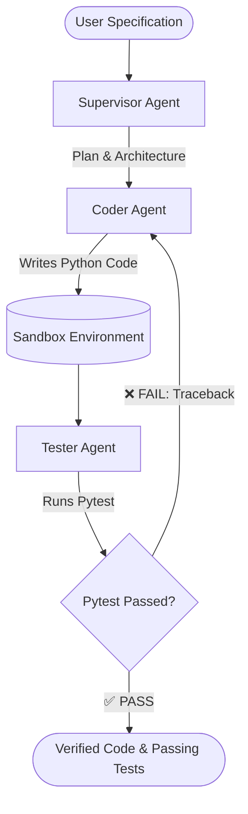

# 🤖 Autonomous Multi-Agent Researcher & Coder

A production-grade multi-agent software development system built in Python, showcasing autonomous planning, code generation, automated pytest verification, and a test-driven self-healing loop.

---

## 🏗️ Architecture



- **Supervisor Agent:** Analyzes the prompt and generates a structured, step-by-step implementation plan.
- **Coder Agent:** Writes clean, idiomatic, fully-typed Python source code into the sandbox.
- **Tester Agent:** Reads the source code, generates comprehensive `pytest` test suites, and runs them.
- **Self-Healing Loop:** If any test fails, the raw traceback and failing assertions are fed back to the Coder Agent to diagnose and patch the bug automatically.

---

## 🚀 Quickstart Guide

### 1. Requirements
- Python 3.10+
- `uv` (recommended) or standard `pip`

### 2. Setup Virtual Environment
```bash
uv venv
.venv\Scripts\activate   # Windows
# source .venv/bin/activate # Linux / macOS
uv pip install -e .
```

### 3. Configuration (`.env`)
Copy `.env.example` to `.env`:
```bash
cp .env.example .env
```

Set your preferred provider:
```ini
# For OpenAI:
LLM_PROVIDER=openai
LLM_MODEL=gpt-4o-mini
OPENAI_API_KEY=sk-...

# Or for local Ollama (100% Free & Offline):
LLM_PROVIDER=ollama
LLM_MODEL=llama3
OLLAMA_BASE_URL=http://localhost:11434/v1
```

### 4. Running the Multi-Agent System
```bash
python src/main.py "Build an in-memory priority queue with max-heap and min-heap support"
```

### 5. Running the System Test Suite
```bash
pytest -v tests/
```
