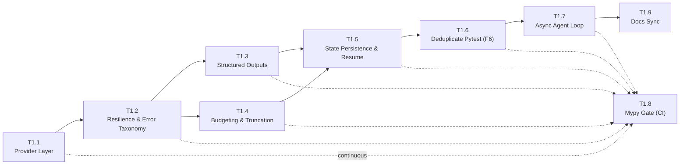

# PHOENIX Phase 1 — Core Reliability: Implementation Plan (Amended)

> [!IMPORTANT]
> Status: **APPROVED FOR IMPLEMENTATION** (Amendments A1–A8 folded in).
> Branching from `v0.1.1` on `phase/1-reliability`. Implementation proceeds
> per-task with mandatory gates. This plan file is committed into
> `docs/plan/phase1-plan.md`.

---

## 1. Architecture Decisions

### 1.1 Provider Layer: Custom Adapters (Justified ADR)

**Decision: Custom Provider Protocol (`src/llm/`) over LiteLLM.**

The scope is exactly three providers: OpenAI-compatible, Anthropic, and Ollama.
Adding LiteLLM for three providers would introduce ≥50 transitive dependencies,
break mypy (heavy runtime monkeypatching, missing stubs), expose a large
unreviewed attack surface, and add an external maintainer as a critical
dependency. All three providers have official first-party Python SDKs.

| Dimension | Custom Protocol | LiteLLM |
|:---|:---|:---|
| **Footprint** | Only existing `openai` + optional `anthropic`, `tenacity` | ≥50 transitive deps |
| **Type safety** | Full mypy strict coverage via Protocol | Runtime dicts, missing stubs |
| **Capability flags** | Explicit, deterministic per-model dataclass | Dynamic dict lookups, can be stale |
| **Code surface we audit** | Exactly our HTTP/SDK calls | Unreviewed proxy + telemetry layers |
| **3-provider scope fit** | Perfect | Overkill; designed for 50+ providers |

The LiteLLM option is declined on **footprint, type safety, control, and
scope** grounds — not on CVE frequency claims, which cannot be verified.

### 1.2 New Dependency Justifications (G6)

| Package | Category | Justification |
|:---|:---|:---|
| `tenacity>=8.3` | Required | Retry logic with injected sleep for deterministic tests |
| `structlog>=24.0` | Required | Structured JSON logs; critical for observability |
| `anthropic>=0.25` | **Optional extra** `[anthropic]` | Lazy-imported; core install stays lean |
| `tiktoken>=0.7` | **Optional extra** `[cost]` | Token counting fallback; lazy-imported |

`anthropic` and `tiktoken` are **optional extras** declared in `pyproject.toml`.
`BaseAgent` performs lazy imports and falls back gracefully if the extras are
absent. The core `pip install .` acquires no extra transitive dependencies.

### 1.3 Cost Table Policy

- Cost rates live in `src/llm/costs.py` as a typed dictionary with a
  `LAST_UPDATED: str` field (date) and a `SOURCE: str` field (URL).
- Unknown models produce `cost_estimate_usd = None` — tokens are **always**
  tracked; cost is tracked only when the rate is known.
- No rate is ever presented as "verified" or "authoritative" at runtime.

### 1.4 OTel/Langfuse Deferral

**Deviation log:** OTel/Langfuse tracing integration is deferred to Phase 4
(Observability sprint). A minimal hook is provided in Phase 1:
`src/llm/tracing.py` defines a `Span` dataclass and a `Tracer` no-op
implementation. Environment variable `PHOENIX_TRACER_ENABLED=langfuse` will
activate the real integration when Phase 4 wires it.

---

## 2. Cross-Cutting Specifications

### 2.1 Retry Taxonomy (A1)

**Retryable errors** (tenacity retries up to max=5):
- `RateLimitError` / `APIStatusError` with `status=429` — honors `Retry-After` header when present.
- `APITimeoutError`
- `APIConnectionError`
- `InternalServerError` / `APIStatusError` with `status >= 500`

**Never retried** (fail fast to `AgentState.error`):
- `4xx` except 429: `400 Bad Request`, `401 Unauthorized`, `403 Forbidden`,
  `404 Not Found` — retrying these never helps.

**Deterministic test injection (A1 requirement):**
```python
@retry(
    retry=retry_if_exception_type(_RETRYABLE),
    wait=wait_exponential_jitter(initial=1, max=60, jitter=1),
    stop=stop_after_attempt(5),
    sleep=injectable_sleep,  # injected; default=asyncio.sleep
    reraise=True,
)
```
Unit tests inject `sleep = lambda s: sleep_log.append(s)` and assert that
recorded sleep values follow exponential growth shape.

### 2.2 Structured Outputs (A2)

**OpenAI path**: Use `client.chat.completions.parse(response_format=TaskPlan)`.
The SDK handles strict JSON schema conversion internally. Requires `openai>=1.40.0`.

**Ollama path**: Probe JSON schema capability via a small test call at
startup. Recent Ollama supports it; do not assume incapacity.
- **Degraded path** (probe fails or response fails to parse): one repair retry
  with explicit system correction message, then set
  `AgentState.plan_degraded = True` and emit a structured log at WARNING level.
  No silent fallback.

### 2.3 Run Lifecycle — Single Source of Truth (A3)

- **Graph owns `run_id`** — it sets `Settings.run_id` exactly once at graph
  initialization. The single-writer rule is documented. Single-run-per-process
  is the Phase 1 supported constraint.
- **`state.json`** carries `{"schema_version": 1, ...}`. On resume, if
  `schema_version` does not match, refuse with:
  `ConfigError("state.json schema version X incompatible with current Y; cannot resume")`
  No silent migration.
- **`PlanStep.completed` criterion**: `completed = True` iff the target file
  exists on disk AND its associated test gate passed in that run.
- **Artifact persistence**: Full tool outputs are written verbatim to
  `run_dir/artifacts/<turn>_<tool>.txt`. Tool outputs are truncated only before
  being appended to the LLM context window.

### 2.4 Test Execution Authority (A4)

- The **TesterAgent** writes the test suite.
- The **Graph** then calls `run_pytest` exactly once per heal cycle,
  deterministically, and builds `TestResult` from that single run.
- The LLM never decides pass/fail. Exit codes map:
  `0=PASS, 1=FAIL, 2=INTERRUPTED, 3=INTERNAL_ERROR, 4=USAGE_ERROR, 5=NO_TESTS_COLLECTED→FAIL`.
- `pytest-json-report` is an optional enhancement; core logic relies on exit
  code and stdout/stderr.

### 2.5 Error Boundaries — BLE001 Strategy (A5)

Narrow catches everywhere meaningful. The single exception is the
**tool-dispatch trust boundary** in `BaseAgent._dispatch_tool()`:
```python
try:
    result = tool_func(**parsed_args)
except Exception as exc:  # noqa: BLE001 — boundary converts to structured ToolError
    logger.exception("tool_dispatch_error", tool=fn_name, exc=exc)
    raise ToolError(tool=fn_name, cause=exc) from exc
```
Module-level `per-file-ignores` are removed file by file as T1.2 refactors
each module. After T1.2 completes, only the `noqa: BLE001` annotation at the
trust boundary remains — no module-level suppressions.

### 2.6 Finding Renaming (A6)

> [!IMPORTANT]
> The NTFS alias bypass finding is renamed **F12** (new finding discovered
> post-baseline, numbered F12+ per G9). The original **F6 remains "duplicate
> pytest run"** addressed by T1.6. This plan, `SECURITY_FIXES.md`,
> `CHANGELOG.md`, `phase0-red-green.md`, and `walkthrough.md` will all be
> updated. The immutable `v0.1.1` tag was created under the old ID; a note
> acknowledging this is added to CHANGELOG.

### 2.7 Offline Test Guard (A8)

All unit tests that touch the provider layer run with socket access blocked:
```python
# conftest.py
@pytest.fixture(autouse=True)
def block_sockets(monkeypatch):
    import socket
    monkeypatch.setattr(socket, "socket", lambda *a, **k: (_ for _ in ()).throw(
        RuntimeError("Network access forbidden in unit tests")))
```
Integration tests (live network calls) are tagged `@pytest.mark.integration`
and excluded by default.

**`pathlib.Path.match("**")` on 3.10–3.13**: The globstar `**` semantics in
`Path.match()` changed between Python versions. This will be verified in CI
and any scoped-tools pattern matching will use `fnmatch.fnmatchcase` instead
to guarantee cross-version consistency.

### 2.8 Async Write Serialization (A8)

- **Independent read-only tool calls** (e.g., `read_file` + `list_directory`)
  are dispatched concurrently via `asyncio.gather`.
- **Write tools** (`write_file`, `run_pytest`) are always serialized
  (sequential, never concurrent) to avoid filesystem race conditions.
- **Synchronous tools** are run via `asyncio.to_thread(tool_func, ...)` to
  avoid blocking the event loop.

---

## 3. Task Breakdown

### T1.1 — Provider Layer (`src/llm/`)

**What:** Establish the LLM provider abstraction.

```
src/llm/
├── __init__.py
├── protocol.py      # LLMProvider Protocol, LLMResponse, TokenUsage, ModelCapabilities
├── openai.py        # OpenAIProvider (OpenAI + OpenAI-compatible Ollama API)
├── anthropic.py     # AnthropicProvider (lazy import)
├── ollama.py        # OllamaProvider with json-schema probe
├── factory.py       # build_provider(settings) -> LLMProvider
├── costs.py         # Cost table with LAST_UPDATED + SOURCE, None for unknown models
└── tracing.py       # No-op Span/Tracer hook for Phase 4
```

**Gate:** `pytest tests/llm/` ✅ · `ruff check .` ✅ · `mypy src/llm` ✅

---

### T1.2 — Resilience, Retries, and Error Taxonomy

**What:** Wire tenacity retries + structured error hierarchy. Eliminate BLE001 per-module.

- Expand `src/errors.py` with full hierarchy (see §2.5 diagram).
- Apply `@retry(...)` with injectable `sleep` in `BaseAgent` and all provider
  calls.
- Narrow blind `except Exception:` in `file_tools.py`, `shell_tools.py`,
  `supervisor.py`, `tester.py`. Add `noqa: BLE001` only at the trust boundary.
- Remove all module-level `BLE001` entries from `pyproject.toml`.
- Surface `MaxStepsExceededError` into `AgentState.error`; remove warning strings.

**Gate:** MockProvider 4×429→success, 6×429→AgentState.error, 500-recovery,
sleep-shape assertions ✅ · `ruff check .` (zero BLE001 suppressions) ✅ ·
`mypy` ✅

---

### T1.3 — Structured Outputs & Schema Enforcement

**What:** Supervisor uses `client.beta.chat.completions.parse(response_format=TaskPlan)`.

- OpenAI: `openai>=1.40.0`; SDK strict conversion; `TaskPlan` as `response_format`.
- Ollama: probe at startup; degraded path sets `AgentState.plan_degraded=True`
  + structured warning log + one repair retry.
- Delete fence-stripping hacks from `supervisor.py`.

**Gate:** `test_structured_output_openai`, `test_structured_output_degraded_path` ✅

---

### T1.4 — Token Counting, Cost Accounting, Tool Output Truncation

**What:** Per-run budget enforcement and transparent cost reporting.

- `src/llm/budget.py`: `BudgetTracker` accumulates usage per call; raises
  `BudgetExceededError` when `max_tokens_per_run` or `max_cost_per_run_usd`
  exceeded.
- Revive `AgentState.history` — appended every turn with `tokens_used`,
  `cost_usd`, `tool_calls`.
- `PlanStep.completed` tracked via criterion in §2.3.
- Full tool outputs → `run_dir/artifacts/`. Truncated version (head+tail at
  `tool_output_max_chars`, default 8000) → LLM context.
- CLI summary emits total tokens + USD cost per run.

**Gate:** `test_budget_exceeded`, `test_truncation_preserves_head_tail`,
`test_cost_none_for_unknown_model` ✅

---

### T1.5 — Atomic State Persistence & Mid-Run Resume

**What:** Durable `state.json` with atomic write and `--resume` CLI flag.

- Atomic write: write `state.json.tmp.<uuid>` → `Path.replace(state.json)`.
- `schema_version = 1` checked on resume; version mismatch → `ConfigError`.
- `MultiAgentGraph.resume(run_id)`: loads `state.json`, validates schema,
  skips completed plan steps (checked via criterion §2.3), re-enters at first
  incomplete step.
- `--resume <run_id>` CLI flag in `src/main.py`.
- Minimal tracing hook (`src/llm/tracing.py`) wired.

**Gate:** `test_mid_run_resume_skips_supervisor` (MockProvider injected kill
after Coder, resume verifies Supervisor NOT re-invoked) ✅ ·
`test_schema_version_mismatch_refuses` ✅

---

### T1.6 — Remove Duplicate Pytest Run (Original F6)

**What:** Single authoritative pytest invocation owned by the Graph.

- Remove second `run_pytest("tests")` call from `TesterAgent.verify_and_test()`.
- Graph calls `run_pytest` once after `TesterAgent` finishes writing the suite.
- Exit code 5 (no tests collected) explicitly mapped to `FAIL`.
- `pytest-json-report` wired if installed, else stdout+exit-code path.
- Update finding references: original F6 = duplicate pytest; NTFS bypass = F12.

**Gate:** `test_pytest_invoked_exactly_once` (spy on `run_pytest`), exit-code
mapping table ✅

---

### T1.7 — Async Agent Execution Loop

**What:** `BaseAgent` and graph go async-native.

- `BaseAgent.run_async()` as primary. `run()` = `asyncio.run(run_async())`.
- Sync tools dispatched via `asyncio.to_thread(...)`.
- Read-only parallel tool dispatch via `asyncio.gather(...)`.
- Write tools serialized (never concurrent).
- `AsyncOpenAI` / `AsyncAnthropic` clients used throughout.

**Gate:** `test_parallel_readonly_tools_run_concurrently`,
`test_write_tools_serialized` ✅ · all 46 existing tests still pass ✅

---

### T1.8 — Mypy Strict Gate + CI Integration (continuous throughout)

**What:** Mypy runs in CI alongside pytest at every matrix version.

- `[tool.mypy] strict = true` in `pyproject.toml`.
- `mypy src tests` added to `.github/workflows/ci.yml` after `pytest`.
- Fix all type errors discovered during T1.1–T1.7.
- Final gate: zero mypy errors on 3.10–3.13.

**Gate:** All 4 matrix jobs (3.10–3.13) pass `mypy` ✅

---

### T1.9 — Docs Sync (A8 addition)

**What:** Keep `.env.example` and `README.md` truthful.

- Add all new settings (`max_tokens_per_run`, `max_cost_per_run_usd`,
  `tool_output_max_chars`, `llm_timeout_seconds`, `PHOENIX_TRACER_ENABLED`,
  `llm_temperature`) to `.env.example` with descriptions.
- Update `README.md`: installation with/without extras, `--resume` flag,
  supported provider list, cost reporting note.
- Remove stale claims (`gpt-5.5`, "Researcher agent", "state machine graph").

**Gate:** Manual review checklist in PR body ✅

---

## 4. Sequencing

T1.8 (mypy gate) runs **continuously** — every task commit must leave mypy green.



Every task ends with **all gates green**: `pytest`, `ruff check .`, `mypy`.

---

## 5. Definition of Done — Phase 1

| # | Criterion |
|---|---|
| 1 | `src/llm/` isolates all LLM calls; OpenAI, Anthropic, Ollama fully functional |
| 2 | 4×429 → success; 6×429 → `AgentState.error`; 500-recovery — all via `MockProvider` |
| 3 | Sleep shape assertions verify backoff; tests run in milliseconds (injected sleep) |
| 4 | `BLE001` removed from `per-file-ignores`; only trust-boundary `noqa` annotation remains |
| 5 | Mid-run kill + `--resume` completes task; Supervisor NOT re-invoked (asserted) |
| 6 | `state.json` version mismatch refuses resume with `ConfigError` |
| 7 | Structured-output degraded path sets `plan_degraded=True` + logs WARNING |
| 8 | `run_pytest` invoked exactly once per heal cycle; exit 5 → FAIL |
| 9 | Full artifacts in `run_dir/artifacts/`; truncated version in LLM context only |
| 10 | CLI reports total tokens + USD cost (or `cost=N/A` for unknown models) |
| 11 | All 4 matrix jobs (3.10–3.13): `pytest` ✅ · `ruff` ✅ · `mypy` ✅ |
| 12 | Offline test guard blocks sockets in unit tests |
| 13 | NTFS finding renamed F12; F6 = duplicate pytest; docs updated everywhere |
| 14 | `.env.example` and `README.md` accurate; stale claims removed |

---

## 6. Deviation Log

| # | Deviation | Resolution |
|---|---|---|
| D1 | v0.1.1 tag commit message referenced "NTFS alias bypass" as F6 | Immutable; note added to CHANGELOG acknowledging old ID |
| D2 | OTel/Langfuse full integration deferred to Phase 4 | Minimal `Tracer` hook delivered in T1.5 |
| D3 | Phase 1 scope is single-run-per-process | Documented constraint; multi-run parallelism deferred to Phase 3 |
