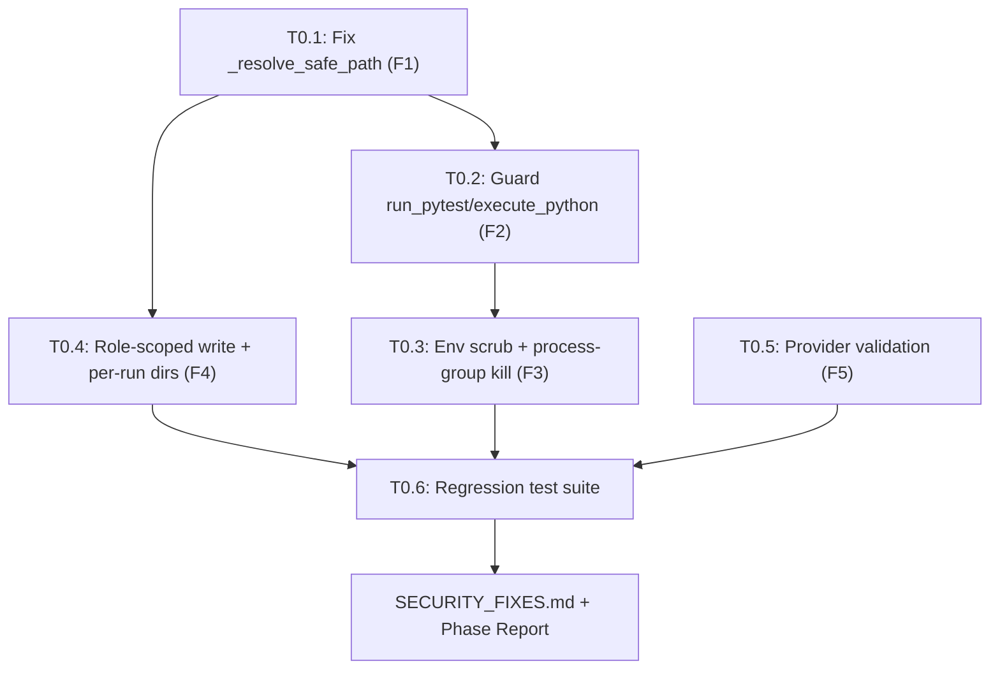

# PHOENIX Phase 0 — Security Hotfix: Implementation Plan

## Goal
Transform the Multi-Agent-Researcher-and-Coder prototype's security posture from **critically vulnerable** to **hardened baseline** by fixing all 5 critical/high findings (F1–F5) and adding comprehensive regression tests, without changing existing CLI behavior.

> [!CAUTION]
> **Phase 0 is a P0 security-only sprint.** No new features, no refactors beyond what is necessary for the fix. Each task produces a failing regression test first (TDD), then the fix. All 6 tasks are sequenced because T0.4 (role-scoped tools) depends on T0.1's hardened guard.

## User Review Required

> [!IMPORTANT]
> **Git Branching**: All work will be on a `phase/0-security-hotfix` branch created from the current `master`. A PR-style summary will be produced at the end — no direct push to `master`.

> [!IMPORTANT]
> **Dependency Changes**: Added `psutil>=5.9.0` for robust cross-platform process tree termination and `mypy` in dev dependencies.

> [!WARNING]
> **Breaking change for `provider="anthropic"` users**: T0.5 makes `anthropic` fail fast at startup with a clear `ConfigError` instead of silently falling through to the OpenAI client with a dummy key. This is intentional — the old behavior was a security/correctness hazard.

---

## Proposed Changes

### Overview Dependency Graph

---

### T0.1 — Fix Path Guard Prefix Bypass (F1)

**Finding**: `_resolve_safe_path` uses `str(resolved).startswith(str(workspace))` which passes for paths like `../sandbox_evil/x` when workspace is `/app/sandbox` (prefix collision).

**Remediation**:
1. Reject absolute paths before joining (defense-in-depth).
2. Replace `str.startswith` with `Path.is_relative_to` (available Python ≥3.9).
3. `.resolve()` follows symlinks, so symlink escape is caught.

---

### T0.2 — Guard Shell Tools Against Path Escape (F2)

**Finding**: `run_pytest` computed `(workspace / test_path).resolve()` with NO sandbox guard. An absolute `test_path` escaped entirely.

**Remediation**:
`run_pytest` routes `test_path` through `_resolve_safe_path`.

---

### T0.3 — Scrub Subprocess Environment + Process-Group Kill (F3)

**Finding**: `subprocess.run` inherits the full parent environment (including `OPENAI_API_KEY`). Timeout kills only the direct child.

**Remediation**:
- Explicit environment allowlist (`PATH`, `PYTHONHASHSEED`, `LANG`, `SYSTEMROOT`, `TEMP`, `TMP`, `COMSPEC`).
- Hybrid process termination via `psutil`: suspend parent -> kill children recursively -> kill parent -> wait.
- Configurable `subprocess_timeout`.

---

### T0.4 — Per-Run Workspace Isolation + Role-Scoped Write Access (F4)

**Finding**: No permission separation. Coder can edit/delete tests to force PASS.

**Remediation**:
- `WritePolicy` factory: Coder denied writes to `tests/*`, Tester allowed only `tests/*`.
- Per-run workspaces under `sandbox/runs/<uuid>/` by default with `sandbox/LATEST` pointer.

---

### T0.5 — Provider Validation + Fail-Fast (F5)

**Finding**: `provider="anthropic"` silently routed to OpenAI client with dummy key `"sk-dummy-for-testing"`.

**Remediation**:
- `ConfigError` raised on missing keys or unimplemented providers.
- Dummy keys removed.

---

### T0.6 — Comprehensive Security Regression Tests

- 44 tests covering path traversal, prefix collision, symlink escape, env scrubbing, grandchild sleeper kill, role write denial, provider validation, and LATEST pointer file.
